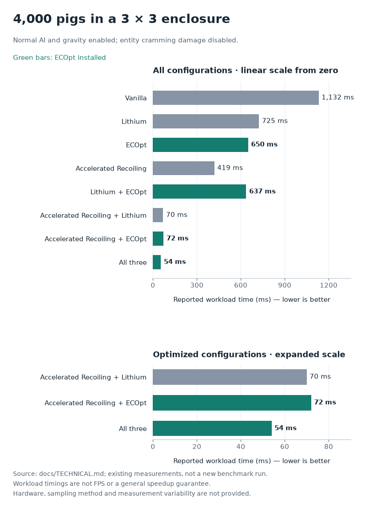
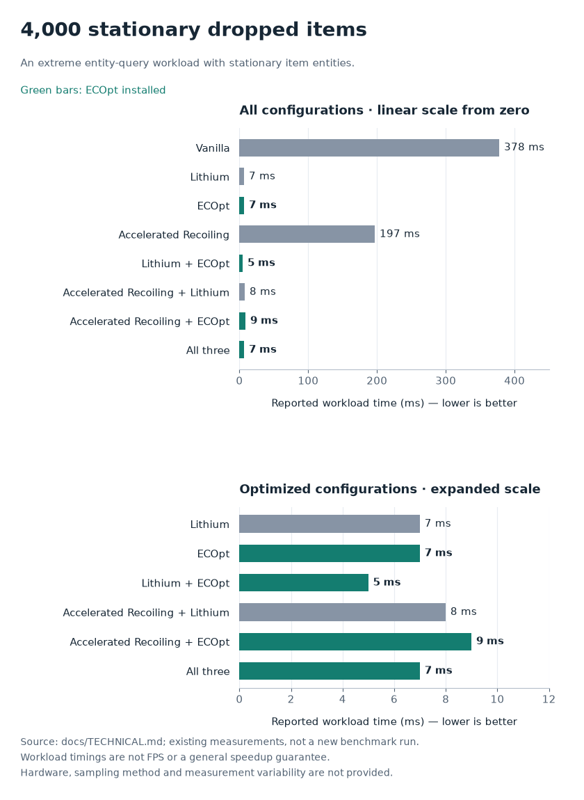

# Entity Collision Optimization

**Less time searching for entities. Less overhead in crowded areas.**

Entity Collision Optimization (**ECOpt**) optimizes entity collision checks, pushing queries, and nearby entity lookups. It targets workloads such as crowded mob farms and large piles of dropped items, where repeated queries can become expensive.

**Minecraft 1.21.1 · NeoForge · No configuration required · MIT license**

## What does it optimize?

- **Collision and pushing queries:** Maintains candidate lists as entities enter and leave sections, reducing repeated filtering.
- **Nearby entity lookups:** Uses spatial indexing for repeated small-area queries to reduce the number of entities scanned.
- **Block-state reads:** Caches block states to reduce repeated lookups during collision processing.
- **Collision checks and vertical movement:** Uses early exits and fast paths to skip unnecessary work.

All optimizations are enabled automatically after installation.

## Performance

The following results come from the project's existing stress tests. **Lower time is better.** These measurements describe the tested workloads, rather than FPS or an expected speedup for every world.

### Crowded mobs: 4,000 pigs

Pigs were placed in a **3 × 3 enclosure**, with normal AI and gravity enabled and entity cramming damage disabled.

ECOpt alone reduced the reported workload time from **1,132 ms to 650 ms**, a **42.6% reduction**. Adding ECOpt to the tested Accelerated Recoiling + Lithium setup reduced it from **70 ms to 54 ms**, a further **22.9% reduction**.

### Dropped items: 4,000 stationary entities

This test used **4,000 stationary dropped items**, an extreme entity-query workload.

ECOpt alone reduced the reported workload time from **378 ms to 7 ms**, a **98.1% reduction** in this test. Lithium + ECOpt recorded the lowest time at **5 ms**.

### Full results

| Installed optimizations | 4,000 pigs | 4,000 dropped items |
| --- | ---: | ---: |
| Vanilla | 1,132 ms | 378 ms |
| Lithium | 725 ms | 7 ms |
| **ECOpt** | **650 ms** | **7 ms** |
| Accelerated Recoiling | 419 ms | 197 ms |
| **Lithium + ECOpt** | **637 ms** | **5 ms** |
| Accelerated Recoiling + Lithium | 70 ms | 8 ms |
| **Accelerated Recoiling + ECOpt** | **72 ms** | **9 ms** |
| **All three** | **54 ms** | **7 ms** |

The full charts use linear axes starting at zero. The detail panels expand the smaller timings for readability and use separate, labeled scales.

**Test context:** Results are taken from the project's `docs/TECHNICAL.md`. The source does not specify hardware, the complete mod versions, sampling duration, repeat counts, or measurement variability. These are illustrative stress-test results; gains will vary with your world, entity counts, and installed mods.

## Using ECOpt with other optimizations

The project's tests include **Lithium** and **Accelerated Recoiling**, both individually and in combination with ECOpt. Their improvements overlap in some areas and complement each other in others, so performance gains do not simply add together.

In the crowded-pig test, the three-mod combination recorded the lowest time. In the stationary-item test, Lithium + ECOpt recorded the lowest time. Choose a combination based on your workload; results from these tested combinations do not establish compatibility with every version or modpack.

## Installation

1. Use **Minecraft 1.21.1** with **NeoForge**.
2. Place the ECOpt `.jar` in your instance's `mods` folder.
3. Launch the game. No configuration is needed.

## Known limitations

The spatial query index changes the order in which entities are returned. Large teleports within the same tick can also exceed the index's movement allowance and may cause a query to miss an entity once. Keep these limitations in mind when testing modpacks with unusual entity movement or query behavior.

## License

Released under the **MIT license**. Created by **FirstSight**.
