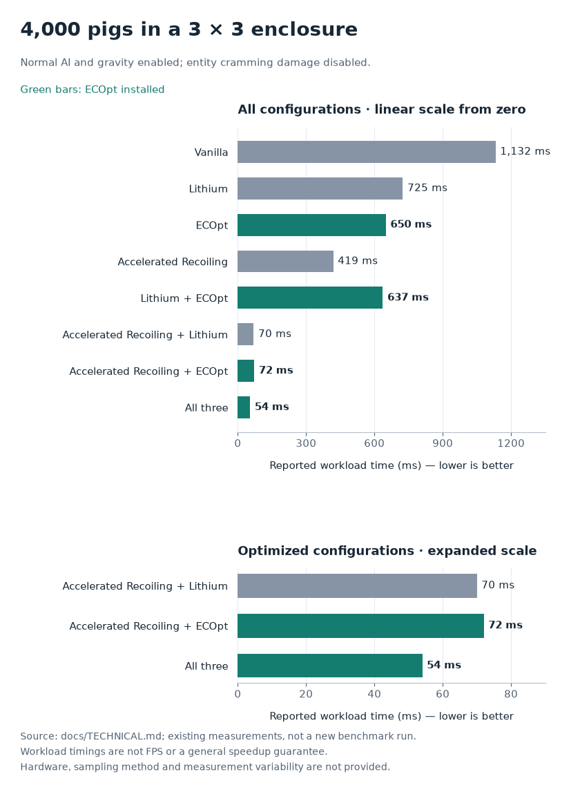
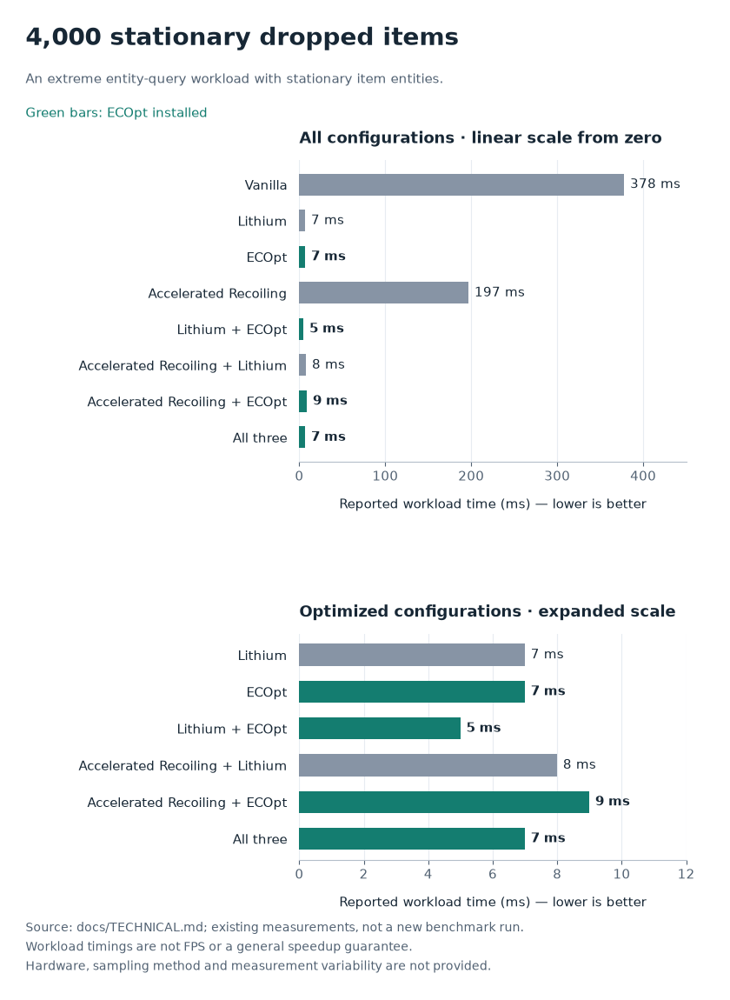

# Entity Collision Optimization · 实体碰撞优化

**减少实体查询开销，让密集实体场景运行得更轻松。**

Entity Collision Optimization（**ECOpt**）专注于优化实体碰撞检测、推挤查询和附近实体检索。当生物聚集、农场中实体密集或掉落物大量堆积时，它通过减少重复遍历与读取，降低这些计算的开销。

**Minecraft 1.21.1 · NeoForge · 安装后自动生效 · 无需配置 · MIT 开源**

## 优化内容

- **实体碰撞与推挤查询：** 随实体进出区段维护候选列表，减少查询时的重复筛选。
- **附近实体检索：** 对重复的小范围查询使用空间索引，减少需要遍历的实体数量。
- **方块状态读取：** 缓存方块状态，减少碰撞处理中对同一位置的重复读取。
- **碰撞检测与竖直移动：** 通过提前返回和快速路径，跳过不必要的计算。

所有优化默认启用，无需调整配置。

## 性能实测

以下数据来自项目已有的压力测试，**耗时越低越好**。图表展示的是测试场景耗时，并非 FPS，也不代表所有世界都能获得相同提升。

### 密集生物：4000 只猪

测试将 **4000 只猪放在 3×3 区域内**，保留正常 AI 与重力，仅关闭挤压伤害。

单独安装 ECOpt 后，测试耗时从 **1132 ms 降至 650 ms，减少约 42.6%**。

在加速碰撞 + Lithium 的组合上加入 ECOpt，耗时从 **70 ms 降至 54 ms，进一步减少约 22.9%**。

### 掉落物堆积：4000 个静止物品实体

测试使用 **4000 个静止的掉落物实体**，属于实体查询的极端负载场景。

单独安装 ECOpt 后，测试耗时从 **378 ms 降至 7 ms，减少约 98.1%**。该场景中，Lithium + ECOpt 组合的记录耗时最低，为 **5 ms**。

### 完整数据

| 优化组合 | 4000 只猪 | 4000 个静止掉落物 |
| --- | ---: | ---: |
| 原版 | 1132 ms | 378 ms |
| Lithium | 725 ms | 7 ms |
| **ECOpt** | **650 ms** | **7 ms** |
| 加速碰撞（Accelerated Recoiling） | 419 ms | 197 ms |
| **Lithium + ECOpt** | **637 ms** | **5 ms** |
| 加速碰撞 + Lithium | 70 ms | 8 ms |
| **加速碰撞 + ECOpt** | **72 ms** | **9 ms** |
| **加速碰撞 + Lithium + ECOpt** | **54 ms** | **7 ms** |

柱状图上方展示全部配置，下方放大低耗时结果；两部分都采用从零开始的线性坐标轴，刻度分别标注。

**测试说明：** 数据引用自项目的 `docs/TECHNICAL.md`，本页面未重新运行测试。原始记录未提供硬件配置、完整模组版本、采样时长、重复次数与误差范围。这些数据用于展示压力测试中的表现，实际收益取决于世界环境、实体数量及模组组合。

## 与其他优化模组搭配

项目已记录 ECOpt 与 **Lithium**、**加速碰撞（Accelerated Recoiling）** 的单独及组合测试结果。它们优化的环节存在重叠，也有互补，因此性能收益不会简单相加。

在本次猪堆积测试中，三者组合耗时最低；在静止掉落物测试中，Lithium + ECOpt 耗时最低。可以根据实际负载选择组合，上述结果仅对应已测试的环境。

## 安装方法

1. 准备 **Minecraft 1.21.1 / NeoForge** 环境。
2. 将 ECOpt 的 `.jar` 文件放入实例的 `mods` 文件夹。
3. 启动游戏，优化自动生效。

## 已知限制

空间索引会改变查询结果中实体的返回顺序。同一 tick 内的大幅瞬移可能超出索引预留的移动余量，理论上可能导致一次查询漏检。包含特殊实体移动或依赖查询顺序的模组时，建议结合实际玩法测试。

## 许可证

采用 **MIT** 许可证，作者：**FirstSight**。
